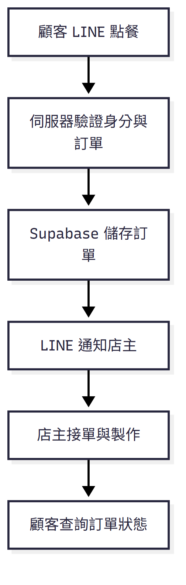
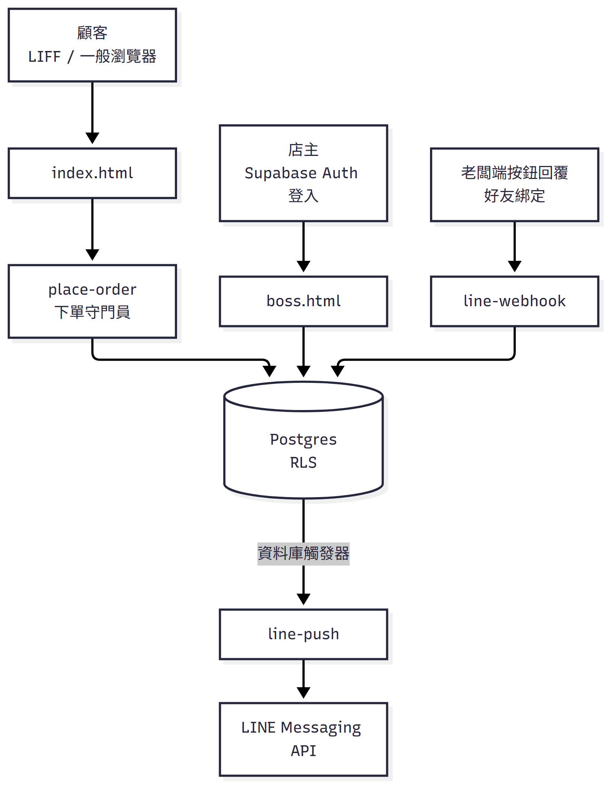
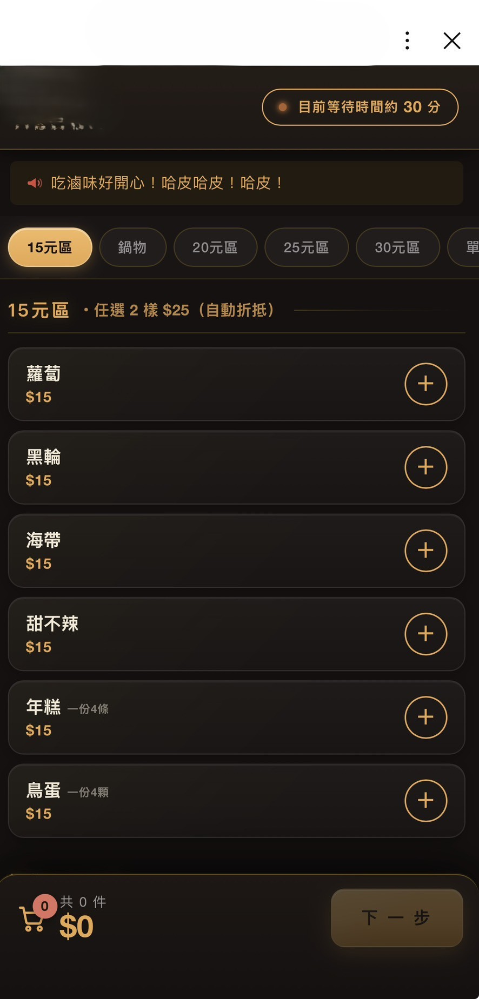
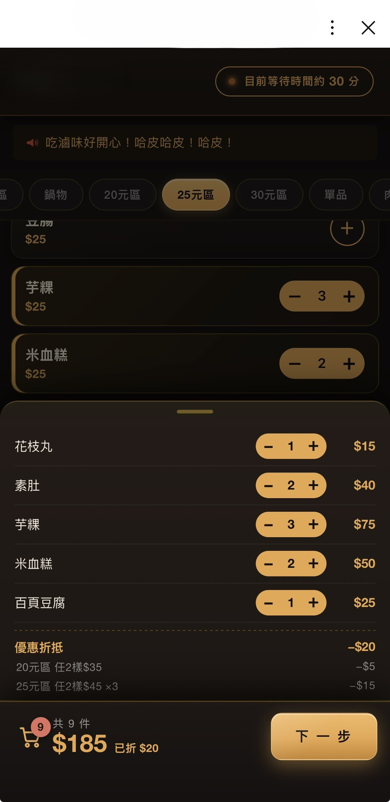
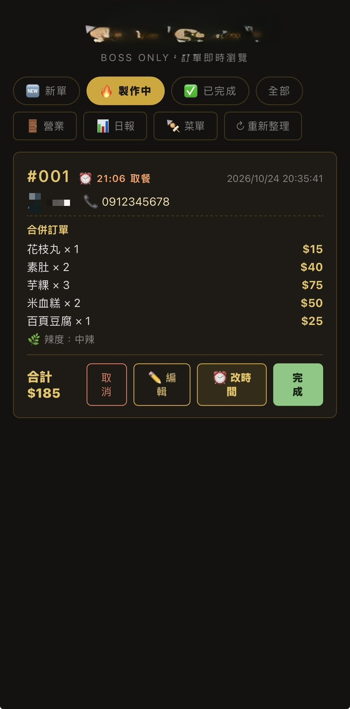
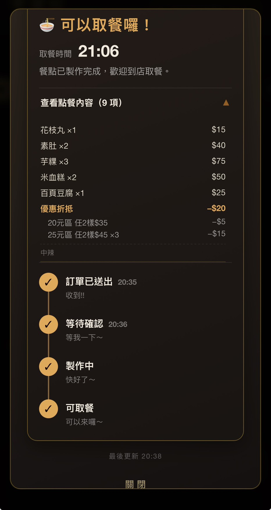

# LINE 點餐系統

**獨立開發的餐飲業 LINE 整合點餐系統，正式上線中**

為在地餐飲店打造的 LINE 整合線上點餐系統，解決電話／紙本點餐容易漏單、尖峰時段人力不足、店家無法即時掌握訂單狀況等問題。獨立完成產品規劃、前後端開發與正式上線維運，目前每天都有真實顧客透過這套系統下單。

## 系統亮點

- **身分驗證備援機制** — 下單身分驗證以 LINE Access Token 為主、ID Token 為備援，任一驗證通過才放行
- **冪等下單** — 行動網路環境下重試是常態；重試沿用同一取餐編號，後端偵測到編號已存在即直接回報成功，不寫入第二筆
- **分層防護，不只靠前端** — 下單一律經 `place-order` 驗證身分；具備人機驗證機制，可依 LINE 內嵌瀏覽器相容性需求啟用；資料庫另有獨立的價格重算與權限政策作第二層防護，且權限政策採分階段收斂（見 [`database/`](database/)）
- **LINE 平台中斷應變** — 整套點餐流程入口鎖在 LINE 裡是優點（每張單都對得到真人），但也是單點風險；設計應急通行碼機制，讓店主能臨時開放瀏覽器直接下單
- **即時店主後台** — 訂單、營業狀態、公休日全雲端同步，多裝置即時反映，一鍵管理菜單與切換營業狀態（正常營業／暫停接單／緊急模式）
- **到店掃碼點餐** — 可列印 QR Code，讓顧客到店直接掃碼進入點餐頁，不限定從 LINE 進入

**技術棧：** Vanilla HTML/CSS/JS（PWA） · Supabase（Postgres + RLS + Edge Functions） · Cloudflare Pages + Turnstile · LINE Messaging API / LIFF · pg_cron

## 點餐流程

以下用虛構資料呈現一筆訂單從下單到完成的完整路徑：



## 系統架構



- **place-order**：驗證 LINE 身分、限流與高額下單警示、冪等防重複送單；具備 Turnstile 人機驗證機制（因 LINE 內嵌瀏覽器相容性考量，目前停用）
- **line-push**：新訂單一律通知店主；顧客端的訂單狀態推播已實作但目前停用，顧客以「訂單查詢」主動確認進度，棄單通知則不受此限制
- **line-webhook**：接收店主在 LINE 對話裡的按鈕操作（接單／完成／取消）與綁定指令
- **Postgres + RLS**：依角色區分讀寫權限，寫入權限隨架構演進逐步收斂，最終統一由 `place-order`（`service_role`）處理（詳見 [`database/`](database/)）

## 關鍵設計決策

幾個會讓系統在真實使用情境下出問題的狀況，決定了大部分的架構選擇：

| 情境 | 問題 | 怎麼處理 |
|---|---|---|
| 顧客端輸入不可信 | 金額、品項、折扣都可能在前端被竄改後送出 | 下單時由伺服器重新查價、重新計算折扣；前端傳來的金額僅供顯示比對，不採信 |
| 行動網路下的重試 | WiFi／訊號切換時「請求成功但回應沒收到」是常態，使用者會手動重按送出 | 冪等設計：前端重試沿用同一取餐編號，後端發現編號已存在就直接回報成功，不再寫入第二筆 |
| 匿名下單仍須隔離資料 | 系統要支援不登入也能下單，但不能讓任何人查到他人的訂單與電話 | Postgres RLS：`select`／`update` 僅限登入的店主帳號；寫入權限隨架構演進分階段收斂，詳見 [`database/`](database/) |
| 單一入口的風險 | 點餐入口鎖在 LINE 裡是優點（每張單都對得到真人），但 LINE 故障會讓線上訂餐全面停擺 | 應急通行碼機制：店主可開啟一組臨時網址，讓顧客在 LINE 以外的瀏覽器下單 |

以「行動網路下的重試」為例，實際的冪等判斷邏輯（[`supabase/functions/place-order/index.ts`](supabase/functions/place-order/index.ts)）：

```ts
// 客人重試時前端沿用同一個取餐編號；後端發現這個編號今天已經存在，
// 就直接回報成功，不再寫入第二筆——重試從此是安全的動作
const { data: dup } = await db.from('orders')
  .select('order_no').eq('order_no', firstNo)
  .gte('created_at', taipeiMidnight).limit(1)

if (dup?.length) {
  return json({ ok: true, duplicate: true, order_nos: records.map(r => r.order_no) }, 200)
}
```

## 測試方式

沒有自動化測試套件，採結構化的手動驗收測試，上線前與每次改版都會覆蓋：

- **真實裝置與網路環境**：在實體手機、LINE 內嵌瀏覽器、一般瀏覽器交叉測試，避免只在開發機上「看起來沒問題」
- **網路不穩情境**：故意模擬斷線重試、同一張訂單用兩支手機同時操作，驗證冪等設計是否真的擋下重複訂單
- **權限邊界測試**：刻意以匿名金鑰嘗試查詢應該被擋下的資料表，確認 RLS 政策沒有漏洞，而不是「寫了就相信它有效」
- **例外情境**：LINE 內嵌瀏覽器環境下人機驗證是否誤判真實使用者、LINE 平台中斷時應急通行碼是否正常運作

## 已知限制與強化計畫

- **`order_no` 目前沒有資料庫層級的唯一性限制**：防重複送單是在應用層判斷「今天是否已有相同編號」，理論上在極端併發情境下仍有極小機率繞過；規劃改為資料庫唯一限制或獨立的 idempotency key
- **部分 `security definer` 函式的執行權限尚未全面收斂**：`next_order_no()` 已明確用 `revoke`／`grant` 限定可呼叫的角色，其餘統計類函式應套用同樣模式，目前還在逐一審查中
- **`database/` 收錄的是代表性子集，不是完整部署歷史**：正式環境的完整資料庫結構目前還沒有全部轉成版本化的遷移檔案

## 部署方式

此專案由三個服務組成，非單一指令可啟動的本地開發環境：

1. **Supabase**：建立專案，依序執行 `database/` 內的 SQL 建立主要資料表與 RLS 政策（代表性子集，詳見資料夾內說明）
2. **Supabase Edge Functions**：部署 `supabase/functions/` 下的四個函式，並設定對應環境變數（見下表）
3. **LINE Developers Console**：建立 Messaging API channel 與 LINE Login（LIFF）channel，取得 Channel Access Token 與 LIFF ID
4. **Cloudflare Pages**：將 `index.html` / `boss.html` 中的佔位符換成實際的 Supabase URL／LIFF ID 後部署

## 環境設定

程式碼中的金鑰與識別碼皆為佔位符，實際部署時需自行設定以下環境變數：

| 變數 | 用途 |
|---|---|
| `SUPABASE_URL` / `SUPABASE_SERVICE_ROLE_KEY` | 資料庫連線 |
| `LINE_CHANNEL_ACCESS_TOKEN` | LINE 推播訊息 |
| `WEBHOOK_SECRET` | 保護推播端點，避免被任意呼叫 |
| `TURNSTILE_SECRET` | Cloudflare Turnstile 人機驗證（目前停用，可視需求啟用） |
| `BOSS_BIND_CODE` | 店主綁定密語 |

## 原始碼結構

| 檔案／資料夾 | 說明 |
|---|---|
| [`index.html`](index.html) | 顧客點餐頁面：LINE 登入、菜單、購物車、訂單查詢、應急模式 |
| [`boss.html`](boss.html) | 店主看單後台：即時訂單看板、營業狀態切換、日報統計 |
| [`design-system.html`](design-system.html) | 視覺設計系統（色彩、字體、元件樣式規範） |
| [`database/`](database/) | Postgres 資料表結構、RLS 權限政策、防刷單與防重複送單規則（依編號順序為各功能的資料庫變更，詳見資料夾內 README） |
| [`supabase/functions/place-order`](supabase/functions/place-order) | 下單 API |
| [`supabase/functions/line-push`](supabase/functions/line-push) | LINE 推播通知 |
| [`supabase/functions/line-webhook`](supabase/functions/line-webhook) | LINE 訊息與按鈕事件處理 |
| [`supabase/functions/admin-setup-richmenu`](supabase/functions/admin-setup-richmenu) | 一次性工具：建立並綁定 LINE 圖文選單 |

## 畫面截圖

| 菜單 | 購物車 |
|---|---|
|  |  |

| 店主後台 | 訂單追蹤 |
|---|---|
|  |  |
